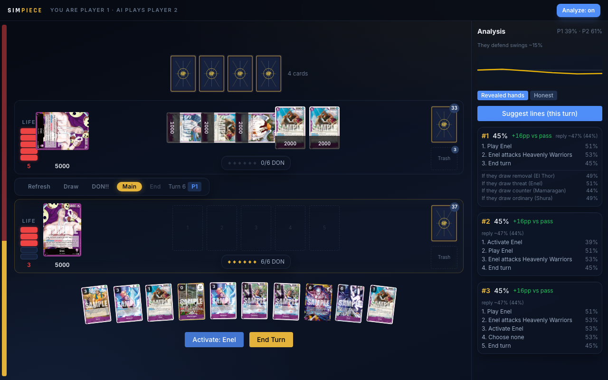

# SimPiece

A web-based One Piece Trading Card Game simulator with drag-and-drop gameplay, automated card effects, a deck builder, and a ladder of AI opponents up to an information-set MCTS that never peeks at hidden cards.

## Demo

The analyzer mid-game against the Hard AI — suggested whole-turn lines with adversarially-verified values, "after their reply" forecasts, per-draw-class branches, and a defense-probability estimate built from the opponent's observed behavior:



Bot vs bot, Purple Enel against Black-Yellow Teach, IS-MCTS on both seats, with the live match log (per-action win probability and attack-quality flags): [docs/demo-enel-vs-teach.webm](docs/demo-enel-vs-teach.webm)

## Features

- Full game loop: mulligan, 5-phase turns (Refresh, Draw, DON!!, Main, End), battle sequence (Attack, Block, Counter, Damage)
- Every card on optcgapi automated through an effect-AST DSL: OP01–OP17, EB01–EB04, PRB01/02 and all 35 starter decks — 2,662 cards, each set certified by a 1,600-game invariant fleet
- AI opponents, simplest to strongest: Greedy (1-ply), Planner (whole-turn beam search with adversarial verification), Honest MCTS (PIMC world voting), Oracle MCTS (sees hidden cards, labeled as such), and IS-MCTS — one shared information-set tree, a fresh determinization per iteration, belief-weighted toward worlds that explain the opponent's observed defenses
- Analyzer: eval bar, suggested lines with worst-case values, opponent-reply forecasts, playing-to-outs mode when behind, lethal certificates
- Spectator mode (`/watch`): pit any two bots against each other with any decks, live match log included
- Frozen meta archetype decks (OP16-era netdecks) plus a deck builder for your own
- Drag-and-drop: drag hand cards to field to play, drag characters to opponents to attack (with arrow visualization); every drag action also works via click + popup menu
- Counter step UI, DON!! attachment, life system with trigger effects
- Pure game engine with full rule validation — deterministic, framework-agnostic, testable

## Tech Stack

React 19, TypeScript (strict), Vite, Zustand, @dnd-kit, TailwindCSS v4, Framer Motion, Vitest

## Installation

Prerequisites: [Node.js](https://nodejs.org) 20 or newer (ships with npm).

```bash
git clone https://github.com/khoile3009/SimOP.git
cd SimOP
npm install
npm run dev
```

Open the URL Vite prints (http://localhost:5173 by default). No API keys, no
database, no backend — card data is static JSON and everything runs in the
browser. Card images load from the Limitless TCG CDN, so the first view of a
card needs a network connection.

Where to go first:

- **/play** — face the AI (difficulty selector: Greedy → Planner → IS-MCTS →
  Oracle) or drive both sides hotseat. Toggle **Analyze** for the line search.
- **/watch** — pick two decks and two bots, then spectate. Open the **Log** for
  per-action win probabilities and defense forecasts.
- **/deck-builder** — build and save decks; they appear in every deck picker.

Verify an install with the test suite:

```bash
npm test
```

## Scripts

| Command | Description |
|---------|-------------|
| `npm run dev` | Start dev server |
| `npm run build` | Type check + production build |
| `npm run test` | Run tests (engine, effects, AI, coverage ledgers) |
| `npm run lint` | ESLint |
| `npm run format` | Prettier format |
| `npm run playtest -- 1600` | Invariant fleet: seeded bot self-play at scale |
| `npm run benchmark -- 20` | Agent-strength ladder on a mirror deck |
| `npm run deffire` | Forced-fire harness: every card effect must fire |
| `npm run selfplay -- 30 gr` | Quick seeded self-play (g=greedy, r=random) |

## Architecture

```
src/
├── engine/       Pure game engine (zero React imports)
│                 GameState + GameAction → new GameState
├── data/         Card data (static JSON) + effect registry
├── store/        Zustand stores (game state, UI state)
├── adapters/     Player input abstraction (Human, AI, Remote)
├── components/   React UI (game board, deck builder, common)
├── hooks/        React hooks (drag, card data, game engine)
└── utils/        Pure helpers (shuffle, IDs, image URLs)
```

The game engine is a pure function: it takes a `GameState` and a `GameAction` (serializable discriminated union) and returns a new `GameState`. This enables unit testing without DOM, deterministic replays, and reuse across AI/network layers.

See [ARCHITECTURE_AND_PLAN.md](./ARCHITECTURE_AND_PLAN.md) for the full spec.

## Roadmap

| Milestone | Scope | Status |
|-----------|-------|--------|
| **V1** | OP01 set, local self-play, deck builder, automated effects | done |
| **P1** | AI opponents (greedy → planner → MCTS family) + analyzer | done — see [BOT_PLAN.md](./BOT_PLAN.md) |
| **Full pool** | Every optcgapi set automated and fleet-certified | done (2,662 cards) |
| **P2** | Online multiplayer via WebSocket | next |
